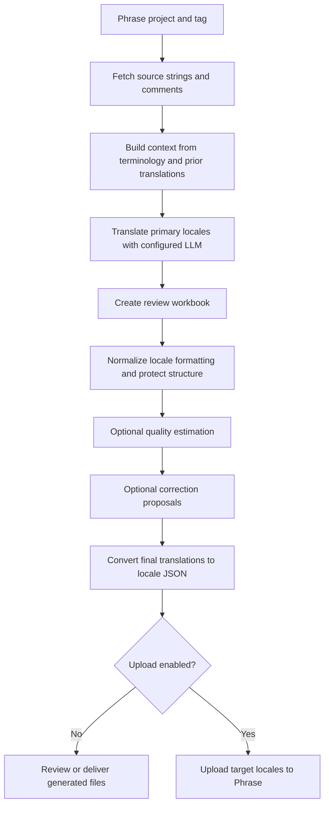

# Phrase Translation Pipeline

> **Portfolio overview — documentation only.** This repository describes a
> multilingual localization pipeline developed as a software project. It does
> not contain the implementation source, credentials, translation resources,
> datasets, generated customer content, or trained quality-estimation models.

The original implementation is maintained separately in a private repository.
This page summarizes its purpose, architecture, workflow, and technology choices
without exposing deployment-specific configuration or employer materials.

## Project at a glance

The project automates a repeatable localization workflow for keyed product and
application text. It takes German source strings managed in Phrase, produces
translations for a configured set of target locales using a selectable large
language model (LLM), normalizes the results, and prepares locale-specific
files for review or upload.

The aim is to reduce manual, repetitive translation operations while improving
consistency across releases. Terminology, prior translations, locale rules, and
structural checks are used to give the model useful context and catch issues
that are easy to miss in a large batch. The system is designed as an
**automation and review aid**: automated scores and proposed corrections do not
replace linguistic review or release approval.

| Area | Summary |
|---|---|
| Source content | Tagged German strings and their keys in Phrase |
| Translation | Context-aware LLM translation into primary target locales |
| Review format | A tabular workbook that can be inspected before publishing |
| Delivery format | One JSON resource file per locale |
| Optional quality checks | Reference-free feature scoring, an LLM judge, and a correction proposal stage |
| Publication | Optional upload of selected target locales back to Phrase |

## Why this project exists

Localization work often spans many keys, languages, plural variants, and
formatting conventions. Processing the same content by hand across multiple
tools can lead to inconsistent terminology, damaged placeholders, locale
formatting errors, duplicated effort, and difficult-to-audit changes.

This pipeline brings those steps into one configurable workflow. It keeps the
source key and original text associated with every result, separates machine
translation from quality review, preserves a spreadsheet as an inspection
point, and makes upload an explicit operational choice rather than an
unavoidable side effect.

## End-to-end workflow

### 1. Select work from Phrase

The orchestrator uses a configured Phrase project and one or more tags to find
the strings in scope. The Phrase integration handles paginated API responses,
retrieves the configured German source locale, gathers available project
locales, and reads relevant key comments where available.

Restricting a run to tagged keys makes it possible to process a release-sized
batch instead of exporting and translating an entire project. Discovering the
project's locale set also lets the pipeline avoid treating every configured
locale as applicable to every project.

### 2. Add terminology and translation context

Before requesting a translation, the pipeline can enrich the prompt with:

- **Terminology entries** from a glossary, so recurring product terms have
  consistent target-language equivalents.
- **Similar previous translations**, found by comparing the German source
  against a context workbook. The most relevant examples can be included in the
  prompt, up to a configurable limit.
- **Phrase comments** associated with a key, when present.
- **Locale-specific guidance**, including language and formality expectations.
- **Structural requirements**, such as preserving placeholders and markup.

An exact-match optimization can reuse a prior translation rather than make an
unnecessary model request when the source text is an exact match and the
configuration permits it.

### 3. Generate translations

The translation component sends the source text, key context, and requested
target locales to the configured model endpoint. A model catalog centralizes
provider-specific information such as deployment names, request formats, token
limits, and whether a model accepts particular generation settings. This keeps
model selection and request construction in one place rather than scattering
provider details throughout the workflow.

The pipeline records run information and translation details for inspection.
The German source is retained as the source value in the output workbook; the
model response is used for target-language content.

### 4. Handle locale variants and plural forms

The configured locale set includes primary translation locales and regional
variants. Some variants can inherit the translation for a designated primary
locale instead of requiring a separate model call. The mapping is explicit and
can be adjusted to the localization policy for a project.

The implementation also contains plural-key handling. It recognizes plural
forms represented by key suffixes, requests the relevant forms for supported
Slavic target locales, and maps the returned forms back to their keys. This
avoids treating a pluralized string as though it were always a single
translation.

The locale configuration in the original implementation includes these
primary targets:

| Locale | Language |
|---|---|
| `cs-CZ` | Czech |
| `da-DK` | Danish |
| `en-GB` | English (United Kingdom) |
| `es-ES` | Spanish (Spain) |
| `fi-FI` | Finnish |
| `fr-FR` | French (France) |
| `it-IT` | Italian (Italy) |
| `nb-NO` | Norwegian Bokmål |
| `nl-NL` | Dutch (Netherlands) |
| `pl-PL` | Polish |
| `pt-PT` | Portuguese (Portugal) |
| `sk-SK` | Slovak |
| `sv-SE` | Swedish (Sweden) |

Regional variants configured as copies include `de-AT`, `de-BE`, `de-CH`,
`de-LU`, `fr-BE`, `fr-CH`, `fr-LU`, `it-CH`, `nl-BE`, and `sv-FI`. The German
source locale is `de-DE`. The live set for a run is further limited to the
locales available in its Phrase project.

### 5. Normalize and preserve structure

Translations pass through locale-specific normalization before delivery. Rules
cover typographic conventions such as quotation marks and apostrophes, as well
as decimal and thousands separators. The normalization stage is intended to
preserve application syntax and source structure, including HTML tags and
interpolation placeholders, rather than rewriting them as ordinary prose.

### 6. Estimate quality and flag work for review (optional)

An optional quality-estimation (QE) stage evaluates translation pairs without
requiring a human reference translation at inference time. It combines
structural and language signals, including:

- Source-to-translation length ratio.
- Preservation of HTML tags and placeholder tokens.
- Use of glossary terminology.
- Cross-lingual semantic similarity features.
- Scores from an LLM-based judge for dimensions such as accuracy, fluency, and
  terminology.

Saved models combine these signals into quality estimates. The workflow
classifies target strings into **Safe**, **Review**, or **Discard** categories
using configurable operating thresholds. It can annotate the workbook with
locale-level review information, so reviewers can focus attention on flagged
items. These categories are automated triage signals, not guarantees of
correctness.

### 7. Propose corrections (optional)

For translations selected for review, the correction stage can ask an LLM to
explain a potential issue and suggest a revised translation. The prompt can
include the source text, terminology, locale guidance, quality-estimation
signals, and structural elements that should remain unchanged.

Corrections are normalized and integrated into the review workflow, with
outputs retained for inspection. The stage is intended to assist human
post-editing; enabling it does not itself authorize publication.

### 8. Export and optionally upload

The final workbook is converted into one JSON file per locale. Key names and
plural suffixes are retained so the resources can be consumed by localization
systems. Upload to Phrase is controlled separately and can be skipped, allowing
the generated files to be reviewed before any remote update. The source locale
is excluded from target-locale uploads.

## Outputs

The implementation generates artifacts under its resources/output directory.
Exact filenames depend on the selected tag and runtime options; typical output
types include:

| Output | Purpose |
|---|---|
| Translation workbook | Wide-format key/locale table for inspection and editing |
| Locale JSON files | One resource file per target locale |
| Translation log | Run-level details and diagnostics |
| QE scores/report | Feature scores and review categories, when QE is enabled |
| Correction report or updated workbook | Proposed edits and review context, when correction is enabled |

Generated resources and real translation content are not included in this
portfolio repository.

## Code organization in the original implementation

The following describes the private implementation, not files contained in
this documentation repository:

| Component | Responsibility |
|---|---|
| `scripts/main.py` | Coordinates configuration, fetching, translation, normalization, optional review stages, JSON generation, and upload |
| `scripts/config.py` | Locale policy, feature flags, model selection, resource paths, and runtime settings |
| `scripts/models_settings.py` | Provider-aware model catalog and request parameters |
| `scripts/phrase_connection.py` | Phrase API calls for locale discovery, source retrieval, comments, and target uploads |
| `scripts/translation.py` | Translation prompts, terminology/context integration, model calls, parsing, and logging |
| `scripts/translation_context.py` | Similarity search over prior translations for reusable examples |
| `scripts/translation_normalization.py` | Locale-specific text normalization and structural-content handling |
| `scripts/translation_evaluation.py` | QE feature orchestration, scoring, and review annotations |
| `scripts/qe_features.py` | Translation-quality feature calculations |
| `scripts/translation_judge.py` | LLM-based quality-judging prompts and response handling |
| `scripts/translation_corrector.py` | Correction proposals for flagged translations |

## Technology stack

The original implementation uses:

- **Python** for orchestration, API integration, transformation, and quality
  checks.
- **Phrase TMS REST API** for retrieving tagged source content and optionally
  uploading target resources.
- **HTTP/JSON APIs** through `requests` for Phrase and configured LLM services.
- **pandas** and **openpyxl** for tabular translation workbooks and Excel-based
  glossary/context resources.
- **NumPy**, **scikit-learn**, **LightGBM**, and **joblib** for feature handling,
  model inference, and persisted QE models.
- **PyTorch**, **sentence-transformers**, and **Transformers** for multilingual
  representation and semantic-quality features.
- **BERTScore**, **SacreBLEU**, and **Levenshtein**-based utilities in
  quality-feature and evaluation workflows.
- **NLTK** and Python's standard library for supporting text processing.

The exact dependency versions and usable model endpoints belong to the private
implementation and its authorized runtime environment; they are not provided
by this portfolio overview.

## Configuration and operational controls

In the original implementation, runtime configuration is supplied through
environment variables and local configuration files. Credentials are expected
to remain outside version control. Typical configuration concerns include:

- Which Phrase project and tag(s) to process.
- Which model/provider is selected for translation and judging.
- Which target locales are available for the selected project.
- Where terminology and prior-translation context are loaded from.
- Whether evaluation, correction, and upload are enabled.
- Output and logging locations.

Upload is a separate control from generating the translations. A run can stop
after producing local artifacts for human review.

## Scope and limitations

- Machine-generated translations and quality scores can be wrong; human
  linguistic and product review remains important.
- Similarity-based context is only as useful as the quality and coverage of the
  supplied glossary and prior-translation data.
- Locale mappings and grammatical guidance are project policy and should be
  reviewed by qualified language owners.
- QE models are dependent on their feature schema, training data, and operating
  thresholds; a score is not a universal measure of translation quality.
- Model availability, cost, rate limits, output formats, and endpoint
  configuration depend on the authorized service account.
- This public repository is a project description, not a runnable distribution.

## Privacy and availability

This repository intentionally contains documentation only. It does not publish
the source implementation, internal service endpoints, project identifiers,
credentials, glossary workbooks, translation data, user content, model weights,
or run outputs. The original implementation and its operational resources are
maintained separately and are not required to read this overview.
